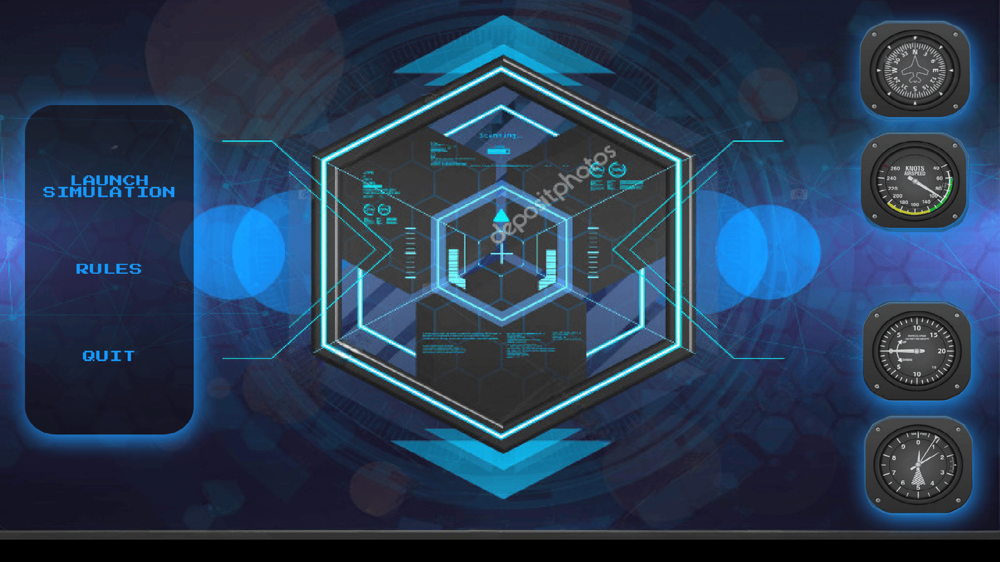

<div align="center">

# My Radar

**Une simulation de trafic aérien en 2D.**

  

<sub>Projet solo · 2023</sub>

</div>

<br/>

<p align="center"></p>

## En deux mots

Des avions décollent, traversent la carte et se détruisent s'ils se percutent, sauf s'ils sont dans la zone d'une tour de contrôle. Tout est décrit dans un fichier script qu'on passe au programme.

## Ce que ça fait

- Script de simulation : avions (départ, arrivée, vitesse, délai) et tours (position, rayon)
- Déplacement des avions et détection des collisions en temps réel
- **Zones de contrôle** des tours qui empêchent les collisions
- Affichage des hitboxes des avions et des zones des tours
- Menu d'accueil et page de règles

<p align="center"></p>
<p align="center"><sub>La simulation : les avions volent vers leur destination, les tours les protègent</sub></p>

## Sous le capot

Le script est parsé en deux passes : on compte d'abord les avions et les tours, puis on remplit les tableaux. À chaque frame, chaque avion avance selon sa vitesse et l'horloge, puis on teste les collisions deux à deux, en ignorant les avions qui sont dans le rayon d'une tour.

## Lancer le projet

```bash
make
./my_radar examples/airspace.rdr
# format : « A x1 y1 x2 y2 vitesse délai » pour un avion, « T x y rayon » pour une tour
```
